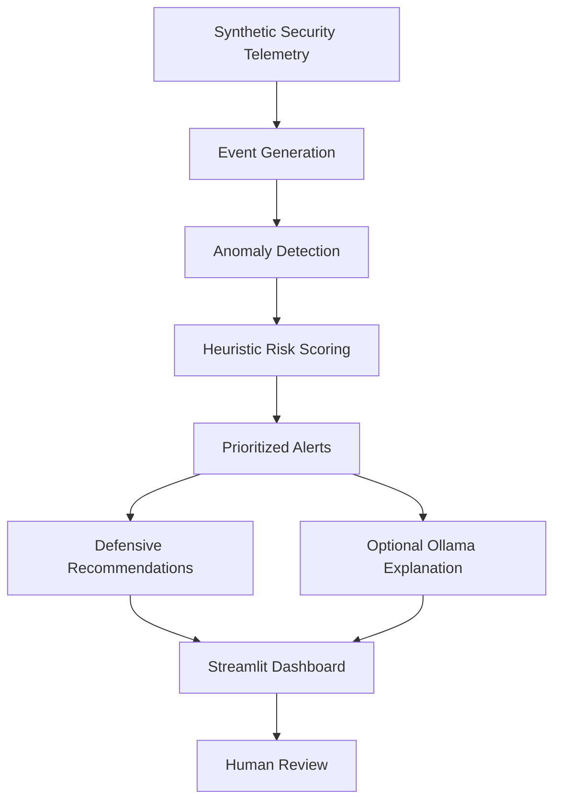

# Sentinel-X 🛡️
### AI-Powered Cyber-Defense Simulation & Anomaly Detection

[](https://sentinel-x-raghuraj.streamlit.app/)
[](https://www.python.org/)
[](https://streamlit.io/)
[](LICENSE)

**Sentinel-X** is an interactive cybersecurity dashboard that demonstrates anomaly detection, explainable risk scoring, and defensive response recommendations using simulated network and security telemetry.

Explore the live dashboard:

**[🚀 Launch Sentinel-X](https://sentinel-x-raghuraj.streamlit.app/)**

> **Important:** Sentinel-X currently uses synthetic demonstration data. It is an educational simulation, not a production intrusion detection system, and it does not establish validated real-world attack prediction performance.

---

## 📌 Table of Contents

- [Overview](#-overview)
- [Features](#-features)
- [Dashboard Preview](#-dashboard-preview)
- [Architecture](#-architecture)
- [Technology Stack](#-technology-stack)
- [Project Structure](#-project-structure)
- [Getting Started](#-getting-started)
- [Running the Dashboard](#-running-the-dashboard)
- [Running Tests](#-running-tests)
- [How Risk Scoring Works](#-how-risk-scoring-works)
- [Optional Local AI Explanations](#-optional-local-ai-explanations)
- [Security and Limitations](#-security-and-limitations)
- [Roadmap](#-roadmap)
- [Contributing](#-contributing)
- [License](#-license)

---

## 🔍 Overview

Security teams need ways to explore suspicious activity, prioritize alerts, and understand possible defensive actions.

Sentinel-X provides a visual demonstration of this workflow. It generates simulated security events, applies anomaly detection, assigns heuristic risk scores, and presents alerts and response recommendations in a Streamlit dashboard.

The project is designed to demonstrate Python development, applied machine learning, data visualization, and responsible cybersecurity prototyping.

## ✨ Features

- **Interactive security dashboard:** View simulated telemetry, anomaly counts, risk levels, and monitored hosts.
- **Synthetic event generation:** Explore generated security events without connecting to a real network.
- **Anomaly detection:** Use an Isolation Forest model trained on synthetic baseline data to identify unusual observations.
- **Explainable risk scoring:** Combine heuristic signals to prioritize events for investigation.
- **Alert prioritization:** Review high-risk events and example attack patterns, including simulated lateral movement.
- **Defensive recommendations:** Display suggested investigation and response actions for human review.
- **Optional local LLM explanations:** Integrate with a locally running Ollama model when configured and available.
- **Evaluation utilities:** Explore demonstration-scoped evaluation results and model behavior.
- **Automated tests:** Run unit tests for event generation, scoring, response recommendations, and demo evaluation.
- **Cloud deployment:** Access the dashboard through Streamlit Community Cloud.

## 🖥️ Dashboard Preview

**Live application:** [sentinel-x-raghuraj.streamlit.app](https://sentinel-x-raghuraj.streamlit.app/)

To add a screenshot:

1. Create a folder named `docs/screenshots`.
2. Capture a screenshot of the running dashboard.
3. Save it as `sentinel-x-dashboard.png` inside that folder.
4. Commit the image to GitHub.

After adding the image, uncomment the following line:

<!--  -->

The screenshot is optional; the live demo link works independently.

## 🏗️ Architecture



### Workflow

1. Generate simulated security events.
2. Process the generated observations through the anomaly detection and scoring logic.
3. Rank suspicious events by their calculated risk.
4. Display metrics, charts, and prioritized alerts.
5. Present defensive recommendations for human review.
6. Optionally request a natural-language explanation from a local Ollama model.

## 🧰 Technology Stack

| Technology | Purpose |
|---|---|
| Python | Application logic |
| Streamlit | Interactive web dashboard |
| NumPy | Numerical operations |
| Pandas | Event and tabular data processing |
| scikit-learn | Isolation Forest anomaly detection |
| Altair | Data visualizations |
| Requests | Optional HTTP communication with a local model |
| Ollama | Optional local LLM explanations |
| pytest | Automated testing |
| Git and GitHub | Version control and source hosting |
| Streamlit Community Cloud | Public application deployment |

## 📁 Project Structure

```text
Sentinel-X/
├── app.py                 # Streamlit dashboard and interface
├── sentinel/
│   ├── __init__.py        # Python package initialization
│   └── engine.py          # Simulation, detection, scoring, recommendations
├── tests/
│   └── test_engine.py     # Automated engine tests
├── requirements.txt       # Python dependencies
├── .env.example           # Example environment configuration
├── .gitignore             # Files excluded from Git
├── LICENSE                # MIT license
└── README.md              # Project documentation
```

## 🚀 Getting Started

### Prerequisites

Install the following:

- Python 3.12 or another Python version compatible with the project dependencies
- Git
- A terminal such as PowerShell
- An internet connection for installing dependencies

### 1. Clone the repository

```powershell
git clone https://github.com/raghuraj72/Sentinel-X.git
cd Sentinel-X
```

### 2. Create a virtual environment

On Windows PowerShell:

```powershell
py -3.12 -m venv .venv
```

Activate it:

```powershell
.\.venv\Scripts\Activate.ps1
```

If Python 3.12 is not installed, use another compatible installed version, such as `py -3.14`, if the dependencies support it.

### 3. Install dependencies

```powershell
python -m pip install --upgrade pip
pip install -r requirements.txt
```

### 4. Start the application

```powershell
streamlit run app.py
```

Streamlit will print a local address, typically:

`http://localhost:8501`

Open that address in your browser.

## ▶️ Running Tests

With the virtual environment activated, run:

```powershell
python -m pytest -v
```

The test suite covers:

- Expected fields in generated events
- Risk scoring and anomaly detector output
- Review-only defensive recommendations
- Evaluation scoped to demonstration data

The initial project test run passed all four tests. Run the tests again after making changes to confirm the current code still passes.

## 🧠 How Risk Scoring Works

Sentinel-X demonstrates a two-part approach:

### Anomaly detection

An Isolation Forest model is trained on a synthetic baseline and used to flag observations that differ from that baseline.

### Heuristic risk scoring

Additional rule-based signals are used to assign a risk score and prioritize events for review.

The dashboard uses those results to highlight suspicious activity and display possible defensive actions.

**A high risk score is a prioritization signal, not proof of an attack.** Detection results depend on the simulated data, model configuration, and scoring rules.

### Evaluation

Evaluation utilities are intended to demonstrate the workflow using the project's synthetic scenarios. They do not establish performance on independently collected network traffic or guarantee a prediction lead time.

## 🤖 Optional Local AI Explanations

Sentinel-X can optionally use an Ollama model running on your own computer to generate natural-language explanations of selected alerts.

For example, a local model may help describe why repeated authentication failures deserve investigation and suggest defensive checks.

To use this feature:

1. Install Ollama from [ollama.com](https://ollama.com/).
2. Download a compatible model supported by your local setup.
3. Start Ollama and verify that the model responds to a test prompt.
4. Configure the application according to the options implemented in `sentinel/engine.py`.
5. Test the dashboard with Ollama both available and unavailable.

Local model availability is optional. The dashboard should be tested independently of the LLM integration.

**Cloud note:** The Ollama service on your personal computer is not automatically available to a Streamlit Community Cloud deployment. A cloud deployment needs an appropriately reachable model endpoint or must operate without this optional feature.

Never expose an unauthenticated model endpoint publicly or commit API keys, passwords, or private credentials to GitHub.

## 🔐 Security and Limitations

Sentinel-X is an educational prototype. Understand the following limitations before using it for security decisions.

- **Synthetic telemetry:** Generated events are not live network traffic.
- **No validated real-world performance:** Demonstration scores and metrics must not be presented as independently validated detection accuracy.
- **No production protection:** The application is not a replacement for an enterprise SIEM, EDR, IDS, firewall, or incident-response process.
- **No automatic enforcement:** Recommendations are intended for human review; the project does not perform real network blocking or remediation.
- **Model limitations:** Synthetic training data may not represent the diversity of real benign and malicious activity.
- **LLM limitations:** Generated explanations can be inaccurate and should be independently checked.
- **Cloud environment:** Local files, services, and models are not automatically available to the deployed application.

Use the project only in environments you own or are authorized to test. Do not interpret simulated alerts as evidence of actual compromise.

## 🗺️ Roadmap

Potential future improvements include:

- [ ] Add documented sample datasets with clear provenance.
- [ ] Evaluate on suitable, independently sourced security datasets.
- [ ] Report precision, recall, F1-score, and false-positive rates where appropriate.
- [ ] Add configurable thresholds and clearer explanations for individual risk signals.
- [ ] Improve logging, error handling, and reproducibility.
- [ ] Add screenshots and a short walkthrough video.
- [ ] Investigate controlled integrations with authorized telemetry sources.
- [ ] Add access control and operational safeguards before any real-world integration.

These are proposed improvements, not claims about existing functionality.

## 🤝 Contributing

Contributions, bug reports, documentation improvements, and ideas are welcome.

1. Fork the repository.
2. Create a feature branch.
3. Make your changes.
4. Run the test suite.
5. Open a pull request describing the changes and tests.

Please avoid submitting secrets, private traffic captures, or sensitive security data.

## 📄 License

This project is distributed under the MIT License. See [LICENSE](LICENSE) for details.

## 👨‍💻 Author

**Raghuraj Pratap Singh**

- GitHub: [@raghuraj72](https://github.com/raghuraj72)
- Project repository: [Sentinel-X](https://github.com/raghuraj72/Sentinel-X)
- Live demo: [Sentinel-X on Streamlit](https://sentinel-x-raghuraj.streamlit.app/)

---

*Built as an educational AI and cybersecurity project to explore anomaly detection, explainable risk prioritization, and defensive investigation workflows.*
